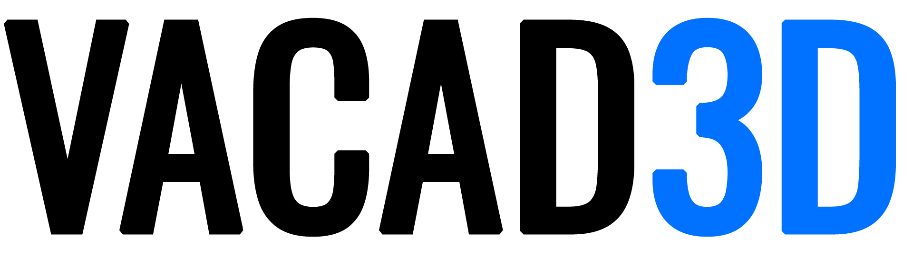
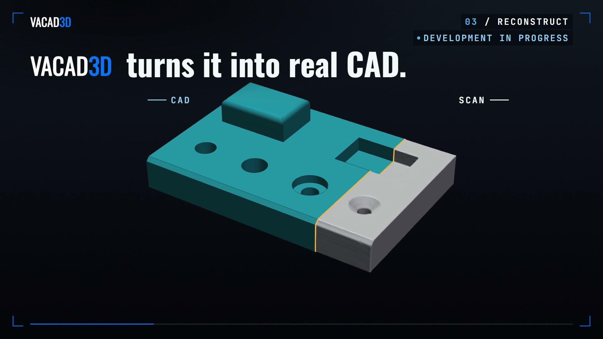
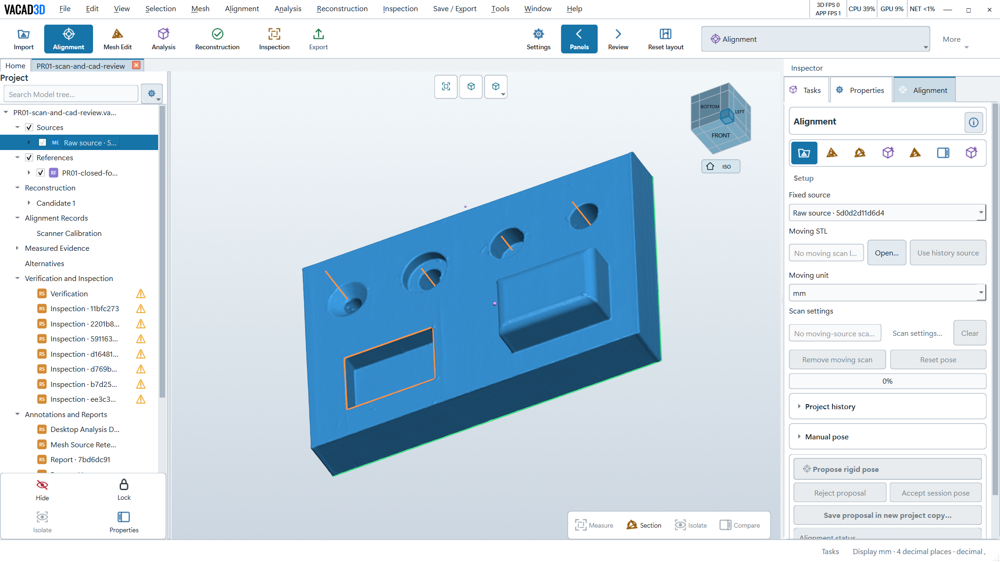
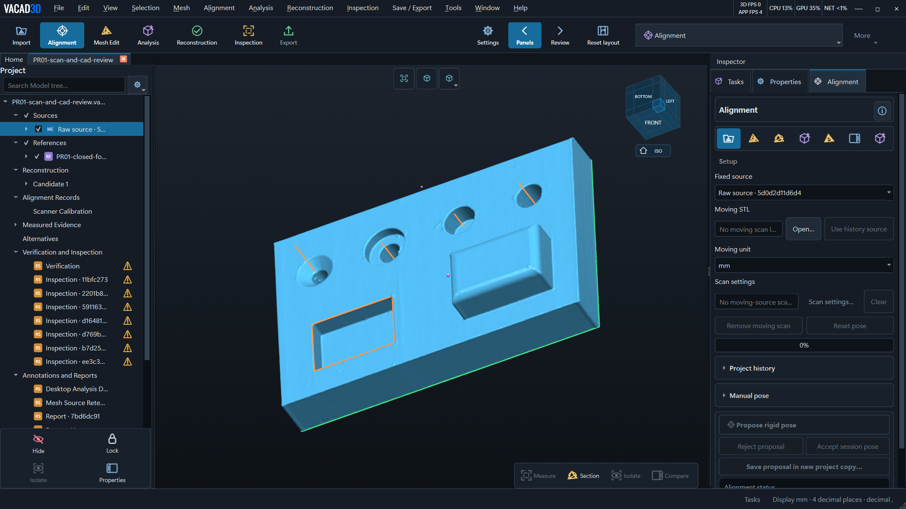
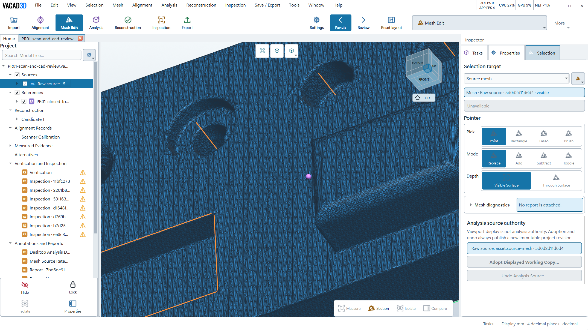
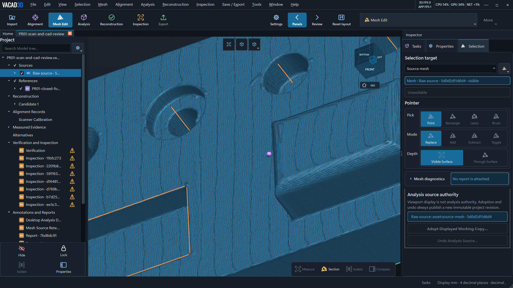
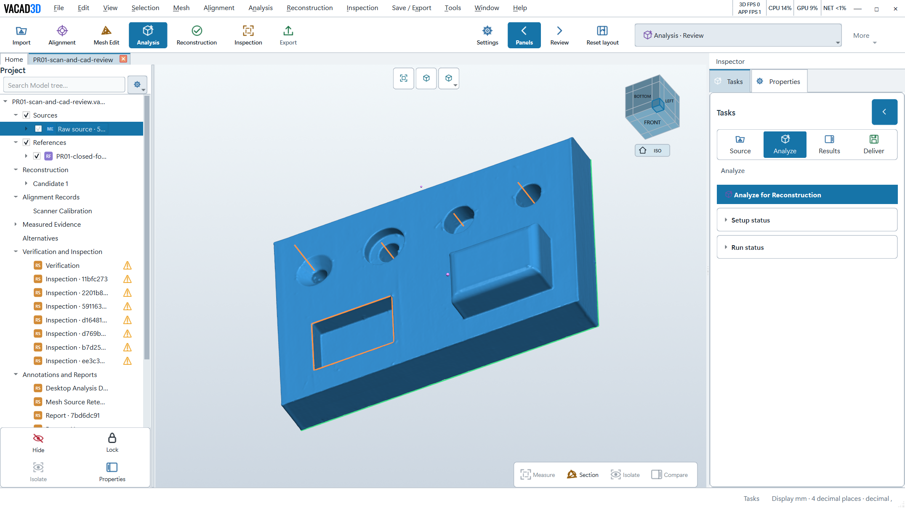
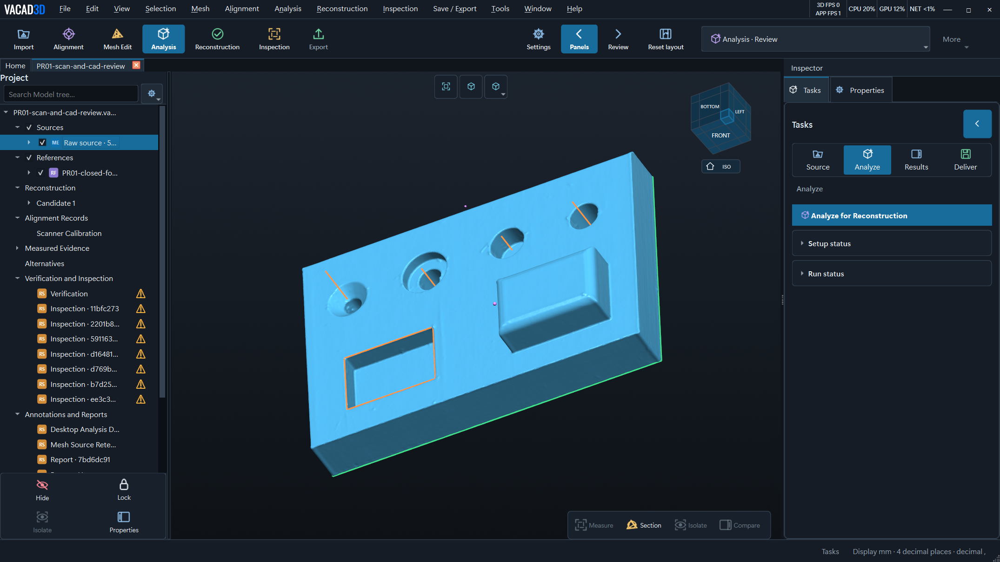

  <picture>
    <source media="(prefers-color-scheme: dark)" srcset="brand/vacad3d-logo-inverse.png">
    
  </picture>

<h3 align="center">Real scans in. Editable CAD out.</h3>

<b>● Development in progress</b> · Investor and partner material · October 2026

   
  ▶ <a href="video/VACAD3D-promo-en.mp4">Watch the 56-second promo video</a> (MP4, 1080p, English narration)

VACAD3D is a desktop application that turns a 3D scan of a mechanical part into a **native, editable CAD model**. You get a FreeCAD feature tree with real holes, pockets, chamfers and fillets, plus a STEP file for your own CAD system. You no longer have to redraw a scanned part by hand.

## Material

| | English | Slovenčina | Deutsch |
|---|---|---|---|
| Promo video, 56 s | [MP4](video/VACAD3D-promo-en.mp4) | coming soon | — |
| Investor & partner deck, 12 slides | [PDF](decks/VACAD3D-investor-deck-en.pdf) | [PDF](decks/VACAD3D-investor-deck-sk.pdf) | [PDF](decks/VACAD3D-investor-deck-de.pdf) |
| App screenshots | [6 PNG](screenshots/) | | |
| Logo | [primary and inverse PNG](brand/) | | |

## What the video shows

- **A real 3D scan** of our own 3D-printed test part, with 713,096 triangles.
- **A native FreeCAD PartDesign model** reconstructed from it: 10 features, including a countersunk hole, a counterbore, a blind hole, a pocket, a chamfer and fillets.
- **A check against the original scan**: 356,544 scan points compared with the CAD surface and shown as a deviation colour map.
- **Edits in FreeCAD 1.1** on the exported model: boss height from 12.62 to 22.00 mm and countersunk-hole diameter from 6.11 to 10.00 mm. The model rebuilds.
- **The desktop application** with its alignment, mesh editing and analysis workspaces, in light and dark themes.

## Screenshots

| Light | Dark |
|---|---|
|  |  |
|  |  |
|  |  |

## Engineering progress

**9,000+** test cases in the repository · **440+** commits · **700,000+** lines of product code · **660,000+** lines of test code

Built with Python, Qt, VTK, FreeCAD and the OpenCASCADE kernel.

## Status

VACAD3D is a working prototype in active development. The results shown come from our own 3D-printed test part, and validation on industry parts is the next step.

## Contact

I'm Adrian. Contact me at **[vacad.adrian@gmail.com](mailto:vacad.adrian@gmail.com)**.
I'm looking for investors and industry partners for a first measured pilot.

---

### Slovensky

VACAD3D je desktopová aplikácia, ktorá z 3D skenu strojnej súčiastky vytvorí natívny, upraviteľný CAD model: strom prvkov vo FreeCADe so skutočnými otvormi, vybraniami, skoseniami a zaobleniami a export do STEP. Prezentácia pre investorov a partnerov: [PDF](decks/VACAD3D-investor-deck-sk.pdf). Video so slovenským komentárom pripravujeme. Projekt je vo vývoji. Kontakt: [vacad.adrian@gmail.com](mailto:vacad.adrian@gmail.com).

### Deutsch

VACAD3D ist eine Desktop-Anwendung, die aus dem 3D-Scan eines mechanischen Bauteils ein natives, bearbeitbares CAD-Modell erzeugt: einen FreeCAD-Konstruktionsbaum mit echten Bohrungen, Taschen, Fasen und Verrundungen sowie STEP-Export. Präsentation für Investoren und Partner: [PDF](decks/VACAD3D-investor-deck-de.pdf). In Entwicklung. Kontakt: [vacad.adrian@gmail.com](mailto:vacad.adrian@gmail.com).

---

## License

**This license is not a license for VACAD3D.** It covers only the promotional material in this repository: the video, the deck PDFs, the screenshots, the logo files and this README. The VACAD3D software, its source code, models, data and documentation are proprietary, all rights reserved. This repository grants no right to use, copy, modify or distribute them.

The promotional material is licensed under [Creative Commons Attribution-NoDerivatives 4.0 International (CC BY-ND 4.0)](LICENSE). You may share it unchanged, in any medium, with credit to VACAD3D. Edited or derived versions may not be distributed.

The license grants no rights to the VACAD3D name or logo beyond sharing this material unchanged. FreeCAD is an independent open-source project; VACAD3D is not affiliated with or endorsed by it.
